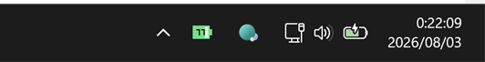

# usagebat

[English](README.md) | [日本語](README.ja.md)


usagebatは、Claude Code・Codex・Cursor・Antigravity（Gemini）の残り利用枠を、macOSのメニューバーまたはWindowsのシステムトレイに小さなピクセルアート電池として表示します。

表示するのは使用率ではなく残量です。`100%`が満タンで、利用するほど電池が減っていきます。

## スクリーンショット

### macOS


### Windows



Windowsのトレイアイコンは正方形に固定されています。既定の`stack`レイアウトでは、表示する制限が1つなら残量%入りのバッテリー、2つ以上なら数字なしの横バーを積み重ねた表示へ自動的に切り替わります。正確な値はツールチップとトレイメニューで確認できます。常に最も逼迫した制限1つだけを表示する場合は、`icon.windowsLayout`を`single`に設定してください。

## 主な機能

- サービスが提供する5時間・週間・月間の実測値を表示
- サービスごとにアイコン表示の有無と期間を選択
- インストール済みのCLIを自動検出
- リセット時刻とトークン詳細をメニューに表示
- ライト／ダークのシステムバーに合わせて配色を変更
- Codexのbanked reset所持数と最短期限を表示
- banked resetの期限7日前と24時間前に一度ずつ通知
- OS言語への自動追従、英語固定、日本語固定に対応
- ログイン時の自動起動とClaude Code／Codexの複数プロファイルに対応

## ダウンロード

[最新のGitHub Release](https://github.com/yutat23/usagebat/releases/latest)から環境に合うファイルをダウンロードしてください。

| 環境 | ファイル |
|---|---|
| macOS（Apple Silicon / Intel） | `usagebat_0.6.3_macOS_universal.zip` |
| Windows Intel / AMD | `usagebat_0.6.3_windows_amd64.zip` |
| Windows on ARM | `usagebat_0.6.3_windows_arm64.zip` |

Claude Code・Codex・Cursor CLI（`agent login`）・[Antigravity CLI](https://antigravity.google/docs/getting-started?tab=cli)（`agy`）のいずれかがインストールされ、ログイン済みである必要があります。

### macOS

1. ZIPを展開します。
2. `usagebat.app`を`/Applications`へ移動します。
3. アプリを開き、メニューバーの電池を確認します。Dockには表示されません。

現在の配布物は公証されていません。初回起動をブロックされた場合は、Controlキーを押しながらアプリをクリックして「開く」を選択してください。

### Windows

1. ZIPを常設するフォルダーへ展開します。
2. `usagebat.exe`を実行します。
3. システムトレイの電池を確認します。最初は隠れているアイコン内に入る場合があります。

現在の配布物はコード署名されていません。Microsoft Defender SmartScreenが表示された場合は、このリポジトリのReleaseから取得したファイルであることを確認してから実行してください。

## メニュー

macOSではメニューバー項目をクリック、Windowsではトレイアイコンを右クリックします。メニューから次を変更できます。

- 各サービスの残量とリセット時刻の確認
- 今すぐ更新
- 「設定…」から、アイコンの表示形式、言語、アイコンに出すサービスと期間を選択
- OS起動時の自動起動
- banked reset期限通知のON/OFF
- 実行中のバージョン確認とGitHubへのリンク
- 終了

既定では、各サービスが実際に報告する最短の制限を選択します。`CL5H`はClaude Codeの5時間枠、`CXWK`はCodexの週間枠、`CUMO`はCursorの請求サイクル枠、`AG5H`はAntigravityのGemini 5時間枠です。

アイコンはシステムバーの外観に追従します。`CL`はClaudeのテラコッタ、`CX`はCodexのティール、`CU`はCursorのバイオレットで、期間の`5H`／`WK`／`MO`はすべて同じ高コントラスト色です。

Claude CodeまたはCodexに複数アカウントを設定すると、アカウントごとに別セルで表示します。`short`を設定すると、汎用の`CL`／`CX`の代わりに`CW`・`CP`のような略称を描きます。名前を付けていない標準アカウントが1つだけの場合は、従来どおりのサービス略称で表示します。

```json
"displaySources": ["claude-code", "codex:codex-work-1a2b"],
"sources": {
  "claudeCode": {
    "profiles": [
      { "path": "~/.claude-work", "label": "Claude Work", "short": "CW" },
      { "path": "~/.claude-home", "label": "Claude Home", "short": "CH" }
    ]
  },
  "codex": {
    "profiles": [
      { "path": "~/.codex-work", "label": "Work", "short": "W" },
      { "path": "~/.codex-home", "label": "Home", "short": "H" }
    ]
  }
}
```

Cursorにプロファイル設定はありません。資格情報ストアが持つアカウントは1台につき1つで、別アカウントにするには`agent login`をやり直して置き換えることになるためです。

`short`はアイコンに描く1〜2文字で、`CL`/`CX`の代わりに表示されます（サービスの区別は色が担います）。メニューとグラフには`label`を使います。
プロファイルの並び順はアイコン・トレイメニュー・グラフで共通です。設定画面の「アカウント」から変更できます。

macOSのメニューバーはアカウントの数だけ横に伸びます。Windowsのトレイアイコンは16ドット四方しかないため、**最大3本まで**とし、超える場合は残量の少ないものを優先します。常に1つだけ見たい場合は`icon.windowsLayout`を`single`にしてください。

## 値の取得元

### Codex

Codex CLIのapp-serverへ`account/rateLimits/read`を要求し、Codex `/status`と同じライブ利用枠を取得します。利用率、リセット時刻、banked reset所持数と明細はサービス報告値で、推定ではありません。

ライブ取得に対応していないCodexでは、`$CODEX_HOME/sessions`内の最新記録へフォールバックします。ただし、フォールバックではbanked reset情報を取得できません。

### Claude Code

現在のClaude Codeが`~/.claude.json`へ保存する利用率キャッシュから、5時間・週間枠とリセット時刻を取得します。追加プロファイルは、それぞれの`CLAUDE_CONFIG_DIR`、利用率キャッシュ、`projects`ディレクトリを使用します。

キャッシュが15分以内ならそのまま使用し、15分を超えた場合や記録されたリセット時刻を過ぎた場合は、`claude -p "/usage" --output-format json`で最新値を取得します。このコマンドが一時的に失敗しても、リセット前のキャッシュは取得時刻を明示して表示します。リセット時刻を過ぎた枠を以前の値のまま表示することはありません。

**表示する利用率はすべてサービスの報告値です。** 報告されない期間は推定せず`?`と表示します。Claudeの月次枠を勝手に作ることもしません。`~/.claude/projects`のトークン集計は引き続き読みますが、期間ごとのトークン量を表示するためだけに使います。

### Cursor

Cursorは利用率をディスク上のどこにもキャッシュせず、CLIにも使用量を表示するコマンドがありません。そのためCursorのダッシュボードAPI（`GetCurrentPeriodUsage` / `GetPlanInfo`）へ直接問い合わせます。認証には`agent login`がこの端末へ保存済みの認証情報を使います。usagebatはこれを**読むだけ**で、設定ファイル・履歴ファイル・ログのいずれにも書かず、送信先もCursorのホストのみです。

CLIの公式コマンド名は`agent`です。`cursor-agent`はバージョン付きインストール先に由来するエイリアスで、実体は同じバイナリです。

**認証情報の保存場所はOSによって違います。CLIがキーチェーンを使うのはmacOSだけです。**

| OS | 一次 | フォールバック |
|---|---|---|
| macOS | ログインキーチェーン（`security`） | `~/.cursor/auth.json` |
| Windows | `%APPDATA%\Cursor\auth.json` | 資格情報マネージャー（`advapi32`直接呼び出し。PowerShellは起動しません） |
| Linux | `$XDG_CONFIG_HOME/cursor/auth.json`（既定 `~/.config/cursor/auth.json`） | `secret-tool` |

Windowsの資格情報マネージャーのエントリ名は（存在する場合）CLIがどのkeychainバインディングでビルドされたかで決まり、ドキュメント化されておらず他プラットフォームとも一致しません。そこで既知の名前を試したうえで、外れた場合はストアを列挙し、名前に`cursor`と（`token`または`access`）の**両方**を含むエントリだけを採用します。両方を必須にしているのは、URLに`cursor`を含むリポジトリのgitパスワードをトークンと取り違えてCursorへ送ってしまわないためです。

WSLへ入れたCLIは資格情報をWSL内に保存するので、Windowsビルドのusagebatからは原理的に見えません。その場合はAPIキーを設定してください。

```json
"sources": { "cursor": { "apiKey": "key_..." } }
```

設定画面には意図的に置いていません。トークンはローカルWebサーバーの入力欄ではなく設定ファイルに置くべきものだからです。

**アカウントが無ければリクエストは一切発生しません。** Cursorがメニューに現れるのはログイン済みのときだけで、判定は独立した2つの信号（上表のいずれかで認証情報が取れるか、または CLI が `~/.cursor/cli-config.json` に書く `authId` の印。このファイルに秘密情報はありません）で行います。macOSのキーチェーン確認は項目の存在だけを見てシークレットを読まないため、Cursorを使っていない端末で許可ダイアログが出ることもありません。どちらか一方でも成立すれば表示します。トークンが読めなかった場合は、黙って消えるのではなく対処できるメッセージを行として表示します。完全に無効化するには`sources.cursor.enabled`を`false`にしてください。

Cursorの枠は請求サイクル単位で、それより短い枠は返ってきません。したがって月間枠として扱い、リセット時刻は`billingCycleEnd`になります。利用率はAPIの`totalPercentUsed`（Cursor CLIが表示するものと同じ値）です。`includedSpend`と`limit`から作り直すことは意図的にしていません。両者は別の尺度で、実測では`totalPercentUsed`が2.9%のときに金額比は50%でした。フィールドが欠けた場合は近い値を推定せず、**値なし**として報告します。

従量課金分は含まれる枠の外側にあり、同じバッテリーには畳めないため、メニューの見出しに`on-demand $0.00 / $50.00`のように表示します。

リクエストは`sources.cursor.minIntervalSeconds`（既定30秒）に1回までスロットルされます。「今すぐ更新」はこれを無視して取得します。取得に失敗した場合は`staleAfterSeconds`（既定900秒）以内に限り、直前の成功値を「前回の取得値」と明示したうえで表示し続けます。

### Antigravity（Gemini）

`agy`をインストールしてログインし、usagebatを起動します。`agy -p /usage --output-format json`が返すGeminiの5時間枠・週間枠の残量とリセット時刻を読み取ります。認証にはCLIのログイン状態が使われます。通常は最大5分間、直近の取得結果を使い、「今すぐ更新」ではその場で取得します。取得の有無は`sources.antigravity.enabled`で設定できます。

## banked resetの期限通知

既定では、期限7日前と24時間前に一度ずつ通知します。

```json
"notifications": {
  "bankedResetExpiry": {
    "enabled": true,
    "thresholdHours": [168, 24]
  }
}
```

通知はresetを消費せず、Codexセッションも作成しません。複数の通知段階を過ぎた状態で起動した場合は、最も緊急な通知を1件だけ表示します。macOSではusagebatアプリのアイコン、Windowsでは`usagebat`のAppUserModelIDに登録したアイコンを使用します。

Windowsのトーストはディスク上の画像ファイルしか参照できないため、`usagebat.exe`と同じディレクトリに`usagebat-toast-icon.png`を書き出します。プログラムのディレクトリを削除すれば一緒に消えます。そのディレクトリに書き込めない場合のみ`%AppData%\usagebat\`に置きます。

通知は期限が実際に迫ったときにしか発火せず、同じ内容は一度しか送られません。動作確認したいときは、実際の通知と同じ経路でテスト通知を送れます。

```sh
# Windows — アイコンの取得元になっているトースト登録情報も表示します
usagebat.exe -notify-test

# macOS — 通知はインストール済みのアプリバンドルからのみ配信されます
/Applications/usagebat.app/Contents/MacOS/usagebat -notify-test
```

## 設定

トレイメニューの「設定…」から、表示、更新間隔、通知、履歴、更新確認、配色、Claude Code／Codexアカウントを設定できます。Cursorはアカウント設定を持たないため、この画面には現れません。変更内容は検証後に保存され、再起動せず反映されます。

設定ファイルは初回起動時に作成されます。

- macOS：`~/Library/Application Support/usagebat/config.json`
- Windows：`%AppData%\usagebat\config.json`

プロバイダやCLIの詳細設定には「設定ファイルを開く…」を使用できます。手動で保存した変更も再起動せず反映されます。

主な設定：

| 設定 | 内容 |
|---|---|
| `language` | `auto`、`en`、`ja` |
| `displayMode` | `both`、`battery`、`percent` |
| `displaySources` | アイコンに表示するサービス |
| `displayLimits` | サービスごとの期間選択 |
| `refreshSeconds` | 更新間隔。既定60秒、最小5秒 |
| `colors.light` / `colors.dark` | テーマ別配色 |
| `notifications.bankedResetExpiry` | 期限通知と通知タイミング |
| `history` | ローカル履歴の記録間隔と保存期間 |
| `updateCheck` | 任意のGitHub更新確認と確認間隔 |
| `sources.claudeCode.profiles` | 追跡するClaude Codeアカウント、`CLAUDE_CONFIG_DIR`、表示名 |
| `sources.codex.profiles` | 追跡するCodexアカウントと表示名 |
| `sources.cursor.enabled` | Cursorを読むかどうか |
| `sources.cursor.apiKey` | OS資格情報ストアの代わりに使うトークン |
| `sources.cursor.minIntervalSeconds` | ダッシュボードへの最短リクエスト間隔 |
| `sources.antigravity.enabled` | Antigravity（Gemini）の利用枠を読むかどうか |
| `notifications.limitThresholds` | 残量が閾値を割ったときの通知 |

## 自動起動

メニューの「OS起動時に自動起動」を有効にしてください。管理者権限は不要です。アプリを移動した場合は、一度無効にしてから再度有効にしてください。

## プライバシー

usagebatには分析サービスがなく、履歴や認証情報を外部へ送信しません。ローカルのCLI状態を読み、Codex CLIへ利用枠を問い合わせ、**Cursorの資格情報が存在する場合に限り**Cursorのダッシュボードへ自分のプラン利用状況を問い合わせます。そのトークンはOSの資格情報ストアから読むだけで、送信先はCursorのホストのみ、usagebatがディスクへ書き出すことはありません。認証はClaude Code・Codex・Cursorが管理します。通知の重複防止状態には、プロファイル・reset ID・期限から作った短いハッシュだけを保存し、生のreset IDは保存しません。

## ソースからのビルド

Go 1.25以降が必要です。

```sh
go install github.com/yutat23/usagebat/cmd/usagebat@v0.6.3
```

通常のデスクトップ利用には、macOSの`.app`やWindows GUIサブシステム設定を含むRelease版を推奨します。

macOSで`go install`した場合は、次のコマンドで通知に必要なアプリ識別情報とアイコンを持つローカルアプリをインストールできます。

```sh
usagebat install-app
```

`~/Applications/usagebat.app`が安全に作成または更新され、そのまま起動します。`go install`で更新した後は、このコマンドをもう一度実行してください。単体バイナリのままでもトレイ表示や利用枠の更新はできますが、ネイティブ通知は利用できません。

```sh
make test
make bundle
make windows
```

## ライセンス

[MIT](LICENSE) © 2026 yutat23
